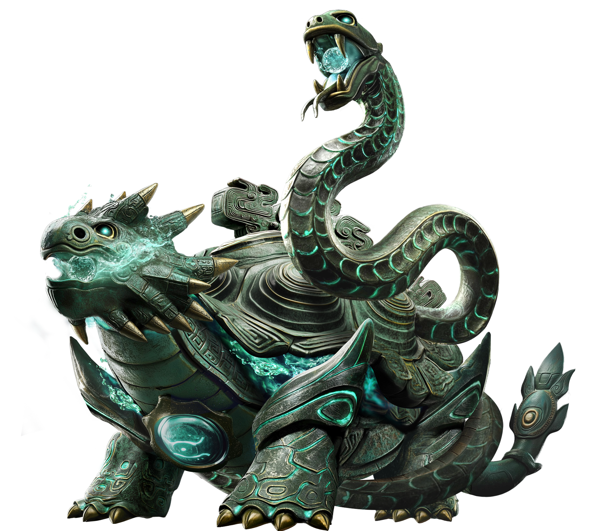
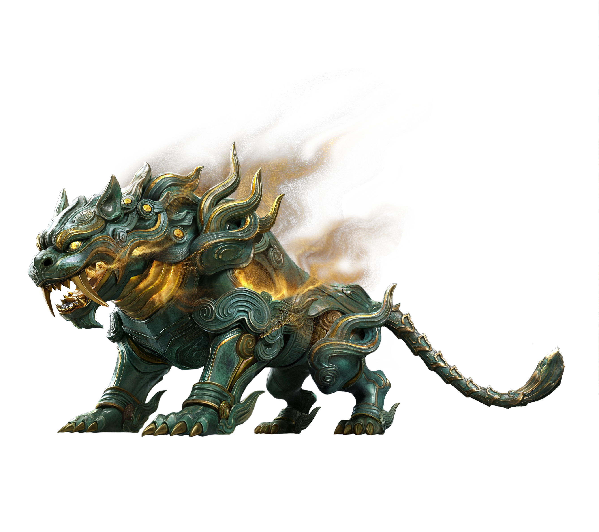
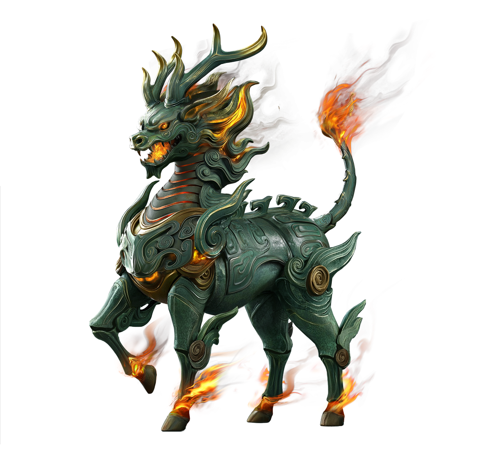

# Thần Thú Trợ Chiến

Hệ thống Thần Thú Trợ Chiến Mùa 2 là tính năng chiến thuật đặc biệt quan trọng, cho phép triệu hồi các Cổ Đại Thần Thú vào chiến trường để xoay chuyển cục diện trận đấu.

## 1. Nguyên Tắc Vận Hành & Phối Hợp

* **Lựa chọn Thần Thú theo Đội Hình:** Chọn Thần Thú bổ trợ trực tiếp cho điểm yếu hoặc phát huy tối đa điểm mạnh của binh chủng chủ lực.
* **Vị Trí Triệu Hồi (Positioning):**
    * *Huyền Vũ:* Hàng tiên phong, đặt ở đầu đội hình để hút sát thương & khống chế.
    * *Bạch Hổ:* Hỗ trợ, đi cùng quân đoàn giao tranh tầm trung.
    * *Kỳ Lân:* Xả sát thương, bắt buộc đứng phía sau lính Cung.
* **Tương Tác Kỹ Năng & Địa Hình:** Kết hợp thời tiết S2 và địa hình hẹp để tối đa hóa sát thương diện rộng của Kỳ Lân hoặc khả năng khóa chân diện rộng của Huyền Vũ.

## 2. Bảng So Sánh Tổng Quan 3 Đại Thần Thú

| Thần Thú | Định Vị Vô Song | Chỉ Số Nổi Bật | Tầm Bắn | Binh Chủng Khuyên Dùng |
| :--- | :--- | :--- | :--- | :--- |
| **Bắc Minh Huyền Vũ** | Hàng Khống Chế / Chịu Đòn Tiên Phong | HP: 1.605.000 Vệ: 138.98 | 2600 mã | Lính Khiên S2 (Đại Kích Sĩ, Thiết Giáp) |
| **Cương Sát Bạch Hổ** | Cân Bằng Hỗ Trợ / Phấn Chấn Quân Đoàn | Tốc Độ: 1200 Công & Vệ Cân Bằng | 4700 mã | Lính Kỵ S2 (Hổ Báo Kỵ, Kỵ Tượng) |
| **Xích Luyện Kỳ Lân** | Tầm Xa Sát Thương / Thiêu Đốt Diện Rộng | Công: 70.74 Tầm Bắn Siêu Xa | 6630 mã | Lính Cung S2 (Vô Đương Phi Quân, Khống Huyền) |

## 3. Chi Tiết Đặc Tính & Bộ Kỹ Năng

### 3.1. Bắc Minh Huyền Vũ (Chúa Tể U Minh Thủy - Tanker Khống Chế)
* { width="500", align=center }
* **Chỉ số cốt lõi:** HP 1.605.000 | Vệ 138.98 | Tốc độ 1000 | Tầm bắn 2600 mã.
* **Kỹ năng:**
    * *Tấn Công Thường:* Tầm 2600 mã, tối đa 5 quân địch. Quật đuôi xả thủy triều gây sát thương, kích hoạt hiệu ứng Khiêu Khích.
    * *Huyền Giáp Phá:* Tầm 6200 mã, tối đa 20 quân địch. Gầm lên Khiêu Khích diện rộng, tạo lớp Khiên Giáp cực dày (hệ số 1200 - 1300).
    * *Huyền Minh Hà:* Đường thẳng & diện rộng. Gầm tung sóng thần gây Choáng 3 giây và gây sát thương nước diện rộng.
* **Mẹo chơi:** Đi cùng Lính Khiên S2 (Đại Kích Sĩ, Thiết Giáp). Đốt kỹ năng `Huyền Giáp Phá` ngay khi địch tràn vào.

### 3.2. Cương Sát Bạch Hổ (Trấn Quỷ Trừ Tà - Cân Bằng Hỗ Trợ)
* { width="500", align=center }
* **Chỉ số cốt lõi:** Tốc độ 1200 | Tầm bắn 4700 mã | Công & Vệ cân bằng ở mức cao.
* **Kỹ năng:**
    * *Tấn Công Thường (Vuốt Hổ Trát Đất):* Tầm 6200 mã hình quạt. Vồ vuốt gây sát thương hệ số 10, tỷ lệ quét ngang hình quạt.
    * *Lôi Trì Phá Trận:* Hào quang 10.000m cho toàn bộ đồng minh. Ban hiệu ứng Phấn Chấn (+12% - 14% Tăng ST & Giảm ST).
    * *Vạn Quân Lôi Vũ:* Tầm 10.000 mã, giáng mưa lôi điện xuống 5 quân địch ngẫu nhiên.
* **Mẹo chơi:** Thích hợp đi cùng Kỵ Binh S2 (Hổ Báo Kỵ, Bạch Mã Nghĩa Tòng). Lao Bạch Hổ vào trung tâm giao tranh đông đúc.

### 3.3. Xích Luyện Kỳ Lân (Tinh Hoa Hỏa Đức - Tầm Xa Bộc Phát)
* { width="500", align=center }
* **Chỉ số cốt lõi:** Công 70.74 | Tầm bắn 6630 mã.
* **Kỹ năng:**
    * *Tấn Công Thường (Hỏa Diễm Phún):* Tầm 2600 mã lan, tối đa 20 quân địch. Phun lửa gây sát thương lan.
    * *Thiên Hỏa Quán:* Tầm 7800 mã. Phóng đại cầu lửa gây sát thương bộc phát (hệ số 25 - 40) và Thiêu Đốt 10 giây.
    * *Thiên Hỏa Thiêu:* Vùng 7800 mã. Trút mưa lửa duy trì 30 giây.
    * *Xích Diễm Thực:* Hào quang toàn bản đồ. Tăng 1% - 2% ST phe ta, tăng 80 - 160 mã Tầm Bắn cho lính Cung.
* **Mẹo chơi:** Đi cùng Lính Cung S2. Đặt ở tuyến sau, dùng `Thiên Hỏa Thiêu` chặn lối đi hẹp.

## 4. Bí Quyết Kết Hợp Thần Thú

* **Combo 1: "Băng Hỏa Liên Hoàn"** (Huyền Vũ + Khống Huyền Sĩ S2 + Thời Tiết Đóng Băng).
* **Combo 2: "Thiên Hỏa Cuồng Phong"** (Kỳ Lân + Vô Đương Phi Quân + Kế Sách Gió Lớn).
* **Combo 3: "Lôi Điện Đột Kích"** (Bạch Hổ + Hổ Báo Kỵ + Quỷ Mưu Điển Tịch).
